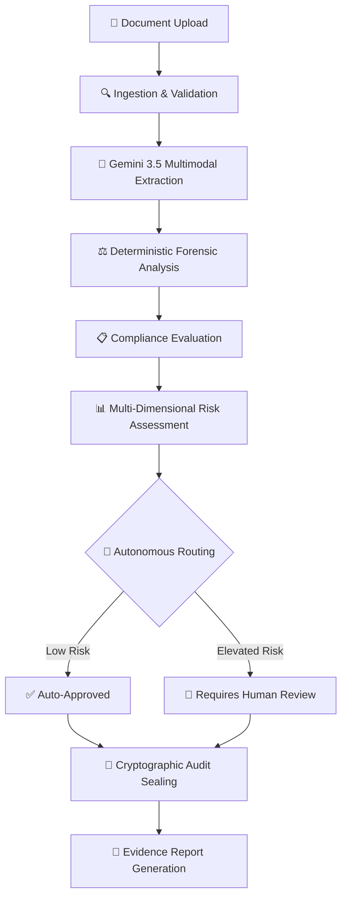
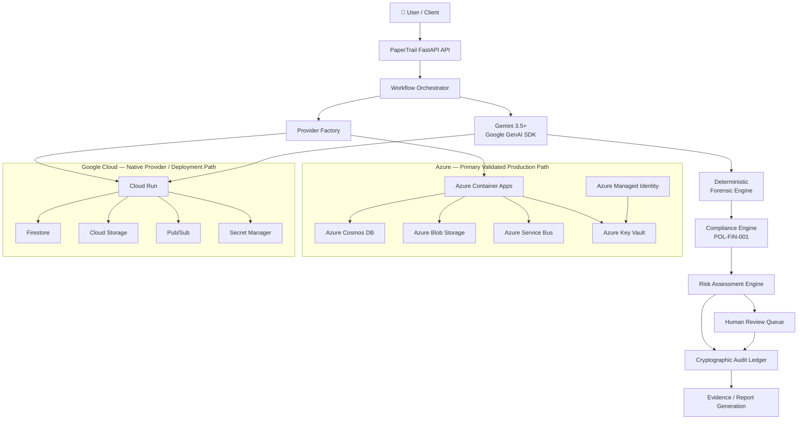
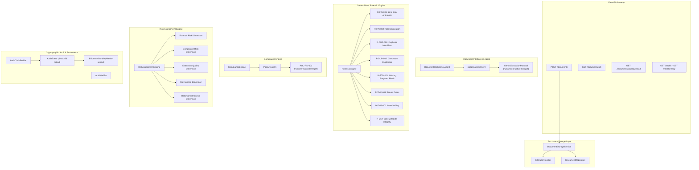

# PaperTrail AI

**Autonomous financial document intelligence agent** that extracts, forensically validates, evaluates compliance, calculates multi-dimensional risk, and cryptographically seals evidence — without human guidance between stages.

> Built for the **All Things Agentic Hackathon 2026** · Python · FastAPI · Gemini 3.5+ · Google GenAI SDK · Google ADK · Provider-Neutral Multi-Cloud Architecture

---

## What Problem It Solves

Financial documents — invoices, receipts, purchase orders — can contain hidden arithmetic inconsistencies, duplicate submissions, missing identifiers, fabricated dates, and other risk signals that conventional OCR tools and general-purpose chatbots do not safely detect.

Existing approaches fall into two failure modes:

1. **Manual review** is slow, inconsistent, and cannot scale.
2. **LLM chatbots** can hallucinate financial values, fabricate invoice numbers when the AI model fails, and provide non-deterministic answers to the same document on repeated runs.

PaperTrail solves this with an **agentic pipeline**: a system that autonomously progresses through document intelligence, forensic analysis, compliance evaluation, risk assessment, and audit sealing — producing deterministic, evidence-backed, cryptographically verifiable results. No human needs to guide the agent between stages. A human reviewer is brought in **only** when the agent's own risk model determines that escalation is required.

---

## Core Value Proposition

Upload a financial document → PaperTrail **autonomously**:

1. Extracts structured data using Gemini 3.5 multimodal intelligence
2. Forensically validates arithmetic, dates, identifiers, and history
3. Evaluates compliance against organizational policies
4. Calculates multi-dimensional risk with exact decimal precision
5. Routes the document (auto-approved or escalated to human review)
6. Seals all evidence into a cryptographic audit chain
7. Generates a tamper-evident report

The entire workflow runs without user intervention after upload.

---

## Why It Is Agentic

PaperTrail is not a chatbot that answers questions about documents. It is an **autonomous multi-stage agent**:

| Property | PaperTrail | Typical LLM Chatbot |
| :--- | :--- | :--- |
| **Execution** | Autonomous background pipeline | User-driven Q&A |
| **Progression** | Event-driven state machine with durable revision locking | Single prompt/response |
| **Routing** | Deterministic risk-based decision | User decides next step |
| **Human involvement** | Only when agent escalates | Every interaction |
| **Determinism** | Same document → same forensic/compliance/risk result | Non-deterministic |
| **Audit trail** | Cryptographic SHA-256 hash chain | None |
| **Failure handling** | Retry semantics, safe failure states, zero fabrication | Hallucination risk |

---

## End-to-End Workflow



---

## Architecture

### Multi-Cloud Provider Architecture

PaperTrail is engineered with a **provider-neutral architecture**. All infrastructure services — databases, object storage, event messaging, and secret management — are abstracted behind Python protocol interfaces and resolved at runtime through a dependency-injection factory (`app/infrastructure/factory.py`). Setting `PAPERTRAIL_CLOUD_PROVIDER=gcp` or `PAPERTRAIL_CLOUD_PROVIDER=azure` switches the entire infrastructure stack with zero code changes.



### Detailed Component Architecture



---

## Google Technologies

PaperTrail uses the following Google technologies as required by the hackathon:

| Requirement | Implementation | Evidence |
| :--- | :--- | :--- |
| **Gemini 3.5+** | `gemini-3.5-flash` for multimodal document extraction | `app/agents/document_intelligence/agent.py` |
| **Google Agent Framework** | `google-genai` SDK + `google-adk` dependency | `requirements.txt`, runtime `genai.Client` initialization |
| **Google Cloud Service** | Cloud Run deployment path, Firestore, GCS, Pub/Sub, Secret Manager | `app/infrastructure/gcp/`, `app/infrastructure/factory.py` |

### Provider Factory Mapping

When `PAPERTRAIL_CLOUD_PROVIDER=gcp`:

| Capability | Google Cloud Implementation |
| :--- | :--- |
| State Manager | `FirestoreStateManager` |
| Workflow Repository | `WorkflowRepository` (Firestore) |
| Document Repository | `DocumentRepository` (Firestore) |
| Audit Repository | `AuditEventRepository` (Firestore) |
| Object Storage | `GCSStorageProvider` |
| Event Publisher | `PubSubPublisher` |
| Event Subscriber | `PubSubSubscriber` |
| Secret Provider | `GCPSecretManagerProvider` |

> **Deployment status**: Azure Container Apps serves as the primary live validated production deployment. The Google Cloud provider path is a fully implemented, factory-wired, and unit-tested deployment target. See [Google Cloud Deployment Guide](docs/deployment/google-cloud.md) for deployment instructions.

---

## Gemini Document Intelligence

The `DocumentIntelligenceAgent` uses Gemini 3.5 Flash via the `google-genai` SDK for multimodal understanding of financial documents:

- **Structured extraction**: Invoice numbers, vendor/customer entities, dates, amounts, line items, currency, and document type are extracted into a validated Pydantic schema (`GeminiExtractionPayload`)
- **Confidence scoring**: Every extraction carries a model-assigned confidence score (0.0–1.0)
- **Zero-hallucination safety**: When Gemini returns an error (rate limit, network, quota), PaperTrail **never fabricates** invoice numbers, vendor names, customer names, totals, or line items. The extraction status is set to `UPSTREAM_FAILURE` and all downstream engines receive null/empty fields rather than invented data
- **Prompt injection defense**: System prompts enforce factual-only extraction with explicit rejection of adversarial document content

---

## Deterministic Forensic Engine

All forensic rules execute in pure Python with exact `Decimal` arithmetic. Zero LLM calls. Zero database reads. Same inputs always produce the same findings.

| Rule ID | Name | Category | Description |
| :--- | :--- | :--- | :--- |
| `R-FIN-001` | Line Item Arithmetic | Financial | Verifies `quantity × unit_price == amount` for every line item |
| `R-FIN-002` | Total Verification | Financial | Verifies sum of line item amounts equals invoice total |
| `R-DUP-001` | Duplicate Identifiers | Duplicate | Detects duplicate invoice numbers across historical submissions |
| `R-DUP-002` | Checksum Duplicates | Duplicate | Detects duplicate document SHA-256 checksums |
| `R-STR-001` | Missing Required Fields | Structural | Flags missing invoice numbers, vendors, customers, dates, or amounts |
| `R-TMP-001` | Future Dates | Temporal | Detects invoice dates set in the future |
| `R-TMP-002` | Date Validity | Temporal | Validates date format and range conformance |
| `R-MET-001` | Metadata Integrity | Metadata | Verifies document metadata consistency |

### Historical Duplicate Detection

The duplicate detection system maintains historical context across all previously processed documents:

- **Invoice number history**: Searches all prior workflows for matching invoice numbers, excluding the current document and current workflow to avoid self-matching
- **Document checksum history**: Searches for identical file SHA-256 hashes across all prior uploads
- **Evidence-backed findings**: Each duplicate detection finding includes the matching historical document ID, workflow ID, and match type

---

## Compliance Engine

The compliance engine evaluates documents against versioned organizational policies.

**Policy `POL-FIN-001` — Invoice Financial Integrity** includes controls for:

- `C-FIN-001`: Financial accuracy (arithmetic correctness)
- `C-FIN-002`: Duplicate submission prevention
- `C-STR-001`: Structural completeness (required field presence)
- `C-TMP-001`: Temporal validity (date reasonableness)
- `C-MET-001`: Metadata integrity

Each control maps to one or more forensic rule findings. Compliance status is determined deterministically from forensic evidence — not from LLM opinions.

---

## Risk Assessment Engine

The risk engine computes a composite score across five independently weighted dimensions using exact `Decimal` arithmetic:

| Dimension | What It Measures |
| :--- | :--- |
| **Forensic Risk** | Severity and count of forensic findings |
| **Compliance Risk** | Number and severity of compliance violations |
| **Extraction Quality** | Gemini extraction confidence and completeness |
| **Provenance** | Document origin and metadata integrity signals |
| **Data Completeness** | Presence of required business fields |

**Risk levels**: LOW (0–25), MEDIUM (25–50), HIGH (50–75), CRITICAL (75–100)

**Autonomous routing logic**:
- Composite score ≤ 25 and zero CRITICAL/HIGH findings → `COMPLETED` (auto-approved)
- Any elevated risk signal → `REQUIRES_REVIEW` (escalated to human reviewer)

The risk engine has **zero LLM dependencies, zero database access, and zero system clock reads** — all context is explicitly injected by the caller.

---

## Human-in-the-Loop Review

When the risk engine determines that a document requires human judgment, the workflow transitions to `REQUIRES_REVIEW`. The review reason is recorded, including:

- Which forensic rules triggered findings
- What severity level was detected
- The composite risk score and contributing dimensions
- Why the document was not auto-approved

A human reviewer can then inspect the full evidence chain — extraction payload, forensic findings, compliance results, risk breakdown, and cryptographic audit trail — before making a final determination.

---

## Cryptographic Audit & Provenance

Every stage of the workflow produces an immutable audit event sealed into a SHA-256 hash chain:

- **Canonical serialization**: Payloads are serialized using deterministic JSON with sorted keys
- **Linked hash chain**: Each `AuditEvent` contains a `previous_hash` field linking to the preceding event, forming an append-only blockchain-style ledger
- **Genesis anchoring**: The first event in every workflow chain uses a well-known genesis hash constant
- **Merkle sealing**: The complete evidence bundle is sealed with a Merkle-style root hash
- **Tamper verification**: `AuditVerifier` can independently recompute and verify the integrity of any chain segment
- **Engine provenance**: Each audit event declares the exact versions of the forensic, compliance, and risk engines that produced the results

---

## Asynchronous Workflow Orchestration

PaperTrail's workflow engine provides durable, event-driven orchestration:

- **Deterministic state machine**: 10 operational states + 3 exceptional states with an explicit transition matrix (`app/core/state.py`)
- **Monotonic revision locking**: Every state transition increments a revision counter, preventing stale-write conflicts
- **Execution claims**: Workers acquire leases before processing, ensuring at-most-once execution per stage
- **Transactional outbox**: Stage completion atomically commits the new state and queues the next event
- **Retry semantics**: Transient failures (Gemini quota, network) trigger configurable retry with backoff
- **Safe failure states**: Permanent failures transition to `FAILED` with a recorded reason, never leaving the workflow in an ambiguous state
- **Event-driven worker**: A background subscriber processes events from the message broker (Service Bus or Pub/Sub) and advances the workflow

---

## Observability & Telemetry

- **Health endpoint** (`GET /health`): Returns service name, version, and phase
- **Readiness endpoint** (`GET /health/ready`): Validates active cloud provider, environment, and dependency configuration status
- **Correlation IDs**: Every HTTP request generates a unique `correlation_id` and `request_id` propagated through all log entries
- **Structured JSON logging**: All log output follows Google Cloud-compatible structured logging format
- **Metrics snapshot** (`GET /metrics`): Application-level counters for workflows processed, documents stored, and errors encountered
- **Sensitive data redaction**: API keys, tokens, connection strings, and credentials are automatically redacted in log output

---

## Validated Functional Tests

Seven rigorous end-to-end tests were executed against the live Azure production deployment:

| # | Test Scenario | Result | Key Observation |
| :--- | :--- | :--- | :--- |
| **1** | Clean invoice — baseline extraction | ✅ PASS | Gemini 3.5 extracted ground-truth entities with 98% confidence |
| **2** | Arithmetic anomaly — line item mismatch | ✅ PASS | `R-FIN-001` correctly detected quantity × price ≠ amount |
| **3** | Duplicate invoice detection | ✅ PASS | `R-DUP-001` and `R-DUP-002` flagged matching invoice number and SHA-256 |
| **4** | Structural anomaly — missing fields | ✅ PASS | `R-STR-001` detected absent required identifiers |
| **5** | Ambiguous / uncertain invoice | ✅ PASS | Zero hallucinated fields; risk engine correctly escalated |
| **6** | Historical duplicate & fallback isolation | ✅ PASS | See note below |
| **7** | Malformed / unusable document | ✅ PASS | Gemini returned null fields without fabrication; risk score 63.56 (HIGH) |

**Test 6 detail**: The initial attempt was blocked by a Gemini 429 (RESOURCE_EXHAUSTED) error. This exposed a fallback-contamination bug where the system fabricated static placeholder values (`INV-1001`, `Standard Vendor`) when Gemini was unavailable. The bug was fixed to ensure upstream failures produce `null` business entities instead of fabricated data. A fresh run with `gemini-3.5-flash` then correctly extracted the real document content. Because this specific invoice (`clean_invoice_739.pdf`) had already been processed in earlier test runs, the historical duplicate detector legitimately identified it as a previously-seen invoice number and routed it to `REQUIRES_REVIEW`. This is correct behavior — not a false positive.

---

## Project Structure

```text
papertrail/
├── app/
│   ├── agents/document_intelligence/   # Gemini 3.5 extraction agent
│   ├── api/routes/                     # FastAPI endpoints
│   ├── audit/                          # Cryptographic audit chain & verification
│   ├── compliance/                     # Policy engine & registry
│   ├── core/                           # Config, state machine, GCP foundation, contracts
│   ├── database/repositories/          # Firestore repository implementations
│   ├── events/                         # Pub/Sub publisher & subscriber
│   ├── forensics/                      # Deterministic forensic rules & engine
│   ├── infrastructure/
│   │   ├── azure/                      # Azure Cosmos DB, Blob, Service Bus, Key Vault
│   │   ├── gcp/                        # GCS storage, Secret Manager
│   │   ├── mock/                       # In-memory providers for testing
│   │   └── factory.py                  # Multi-cloud dependency injection factory
│   ├── models/                         # Pydantic domain models
│   ├── orchestration/                  # Workflow orchestrator & state manager
│   ├── reports/                        # PDF & JSON report generation
│   ├── risk/                           # Multi-dimensional risk engine
│   └── services/                       # Business service layer
├── tests/
│   ├── unit/                           # 293 unit tests (including GCP provider hardening)
│   ├── integration/                    # Azure & Firestore integration tests
│   ├── parity/                         # Cross-cloud deterministic parity tests
│   └── e2e/                            # End-to-end pipeline tests
├── docs/
│   ├── deployment/google-cloud.md      # Google Cloud Run deployment guide
│   └── *.md                            # Component documentation
├── Dockerfile                          # Multi-stage lean container (Cloud Run compatible)
├── requirements.txt                    # Python dependencies
└── requirements-azure.txt             # Azure-specific SDK dependencies
```

---

## Running Tests

```bash
# Full verification suite (293 tests, no cloud credentials required)
pytest -v

# Expected result: 293 passed, 4 skipped, 0 failures
```

---

## Deployment

### Google Cloud (Cloud Run)

See [docs/deployment/google-cloud.md](docs/deployment/google-cloud.md) for complete instructions.

```bash
gcloud run deploy papertrail-api \
  --source . \
  --region us-central1 \
  --allow-unauthenticated \
  --set-env-vars "PAPERTRAIL_CLOUD_PROVIDER=gcp,GEMINI_MODEL=gemini-3.5-flash" \
  --set-secrets "GEMINI_API_KEY=papertrail-gemini-api-key:latest"
```

### Azure (Container Apps)

The primary validated production deployment runs on Azure Container Apps with Cosmos DB, Blob Storage, Service Bus, and Key Vault.

```bash
az containerapp up --name papertrail-api \
  --source . \
  --environment papertrail-env \
  --env-vars PAPERTRAIL_CLOUD_PROVIDER=azure
```

---

## Technical Documentation

- [Google Cloud Deployment Guide](docs/deployment/google-cloud.md)
- [GCP Foundation Architecture](docs/gcp_foundation.md)
- [Core State Machine Specification](docs/state_machine.md)
- [Firestore Workflow Repository](docs/firestore_repository.md)
- [Document Storage Layer](docs/document_storage.md)
- [FastAPI Gateway](docs/fastapi_gateway.md)
- [Document Intelligence Agent](docs/document_intelligence_agent.md)
- [Deterministic Forensic Engine](docs/forensic_engine.md)
- [Deterministic Compliance Engine](docs/compliance_engine.md)
- [Deterministic Risk Assessment Engine](docs/risk_engine.md)
- [Cryptographic Audit & Provenance](docs/audit_provenance.md)
- [Deterministic Audit Report Generation](docs/report_generation.md)

---

## License

Built for the All Things Agentic Hackathon 2026.
