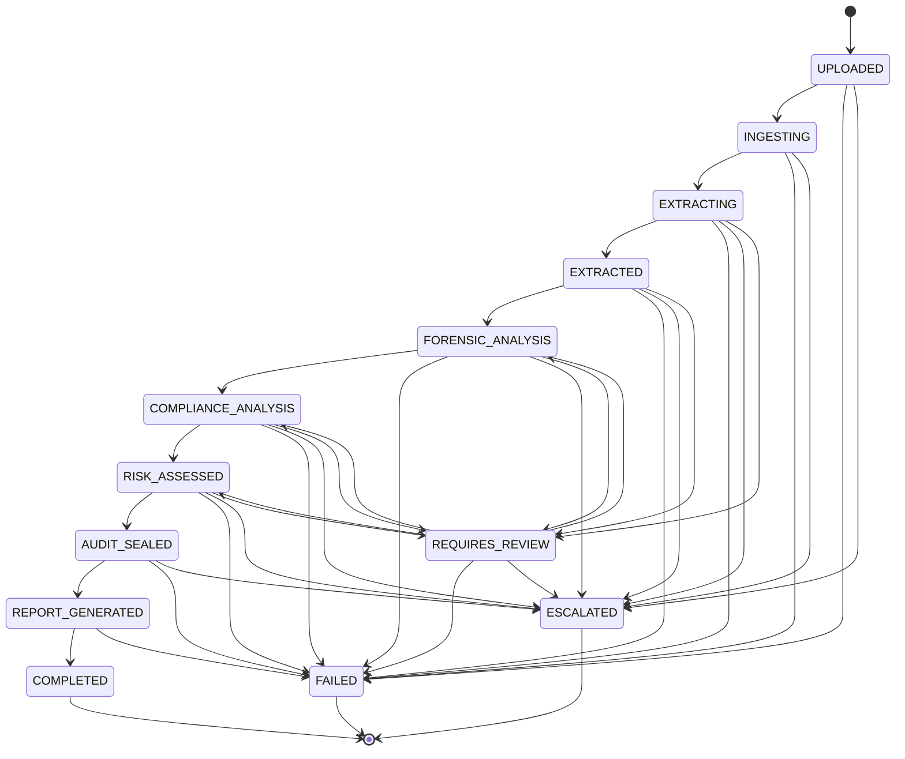

# PaperTrail AI — Core State Machine & Workflow Lifecycle

This document defines the **Deterministic Document Analysis State Machine** (`app/core/state.py`) for **PaperTrail AI**, submitted for the **All Things Agentic Hackathon 2026**.

---

## 1. Architecture Rationale & Core Principles

- **State is the Source of Truth**: All document workflow states are strictly controlled by deterministic Python code. Gemini AI and external components process data within designated states but cannot unilaterally modify or skip workflow stages.
- **Explicit Valid Transition Matrix**: State transitions are strictly constrained by `VALID_TRANSITIONS`. Invalid transitions immediately fail safely by throwing a `StateTransitionError`.
- **Terminal State Protection**: Terminal states (`COMPLETED`, `FAILED`, `ESCALATED`) permanently reject further transitions.
- **Timestamp Integrity**: The `created_at` timestamp is immutable upon workflow creation, while `updated_at` is updated automatically on every valid transition and remains untouched when invalid transitions fail.

---

## 2. Mermaid Workflow State Lifecycle Diagram

---

## 3. Workflow State Definitions

| State | Category | Description |
| :--- | :--- | :--- |
| `UPLOADED` | Operational | Document submitted successfully to PaperTrail AI. |
| `INGESTING` | Operational | Document being prepared, decoded, and normalized. |
| `EXTRACTING` | Operational | Document Intelligence Agent extracting structured information. |
| `EXTRACTED` | Operational | Extraction completed; schema validation verified. |
| `FORENSIC_ANALYSIS` | Operational | Forensic anomaly engine & Gemini contextual analysis active. |
| `COMPLIANCE_ANALYSIS` | Operational | Compliance rules & policy engine evaluating document evidence. |
| `RISK_ASSESSED` | Operational | Deterministic risk score aggregation completed. |
| `AUDIT_SEALED` | Operational | Cryptographic SHA-256 audit chain sealed. |
| `REPORT_GENERATED` | Operational | Executive PDF audit summary generated. |
| `COMPLETED` | Terminal | Workflow successfully finished. |
| `FAILED` | Terminal | Unrecoverable technical failure occurred during processing. |
| `ESCALATED` | Terminal | Exceptional case escalated for administrative handling. |
| `REQUIRES_REVIEW` | Exceptional | Workflow flagged for mandatory human inspection. |

---

## 4. Transition Rules & Exception Semantics

- **Happy Path Matrix**:
  `UPLOADED` → `INGESTING` → `EXTRACTING` → `EXTRACTED` → `FORENSIC_ANALYSIS` → `COMPLIANCE_ANALYSIS` → `RISK_ASSESSED` → `AUDIT_SEALED` → `REPORT_GENERATED` → `COMPLETED`

- **Invalid Transition Handling**:
  Attempting illegal transitions (e.g. `UPLOADED` → `COMPLETED` or `RISK_ASSESSED` → `EXTRACTING`) raises `StateTransitionError` and leaves workflow state and timestamps untouched.
