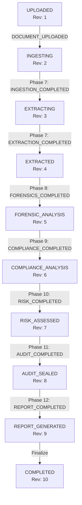

# Phase 13 — Deterministic Workflow Orchestration & End-to-End Pipeline

## Overview

Phase 13 implements the **Deterministic Workflow Orchestration & End-to-End Pipeline Layer** for PaperTrail AI. It provides an event-driven, fault-tolerant orchestration architecture backed by Google Cloud Pub/Sub and Google Cloud Firestore.

The orchestrator coordinates the complete analysis lifecycle across all deterministic engines:
1. **Phase 7**: Document Intelligence (Ingestion & Extraction)
2. **Phase 8**: Deterministic Forensic Engine
3. **Phase 9**: Deterministic Compliance Engine
4. **Phase 10**: Deterministic Risk Assessment Engine
5. **Phase 11**: Cryptographic Audit & Provenance Layer
6. **Phase 12**: Deterministic Audit Report Generator

---

## Architectural Principles & Invariants

1. **State Machine Authority**: `AnalysisWorkflow` (`app/core/state.py`) is the single source of state truth. All transitions are validated against `VALID_TRANSITIONS`.
2. **Monotonic Workflow Revision**: State mutations increment `workflow_revision` monotonically (`1: UPLOADED`, `2: INGESTING`, `3: EXTRACTING`, etc.).
3. **Transactional Outbox Pattern**: State updates and outgoing `WorkflowOutboxEvent` records are written in a single atomic Firestore transaction (`@firestore.transactional`).
4. **Execution Claim Leases**: Workers acquire `WorkflowExecutionClaim` leases (`CLAIMED`, `RUNNING`, `COMPLETED`, `FAILED`, `EXPIRED`) with TTL `lease_expires_at` to prevent concurrent workers from running the same expensive adapter simultaneously.
5. **At-Least-Once Delivery Semantics**: System guarantees deterministic convergence over at-least-once message delivery using logical event key idempotency deduplication (`workflow_id:workflow_revision:event_type`).

---

## State Transition Matrix

---

## API Endpoints

- `POST /api/v1/pipeline/start`: Trigger new pipeline execution for a document.
- `GET /api/v1/pipeline/{workflow_id}/status`: Inspect workflow state, revision, and execution details.
- `POST /api/v1/pipeline/{workflow_id}/resume`: Resume workflow stalled in `REQUIRES_REVIEW` state after human review approval. Requires authenticated reviewer header `X-Reviewer-Principal`.
